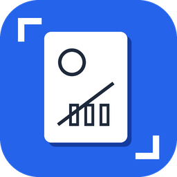
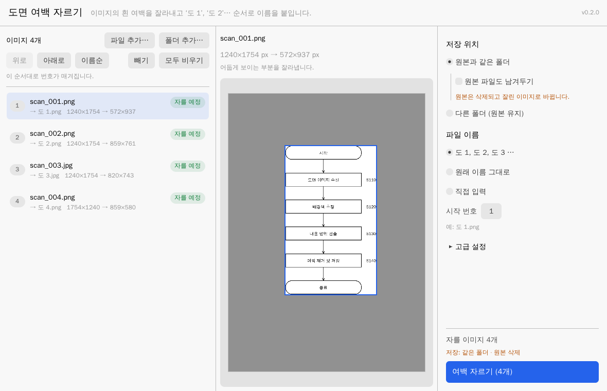
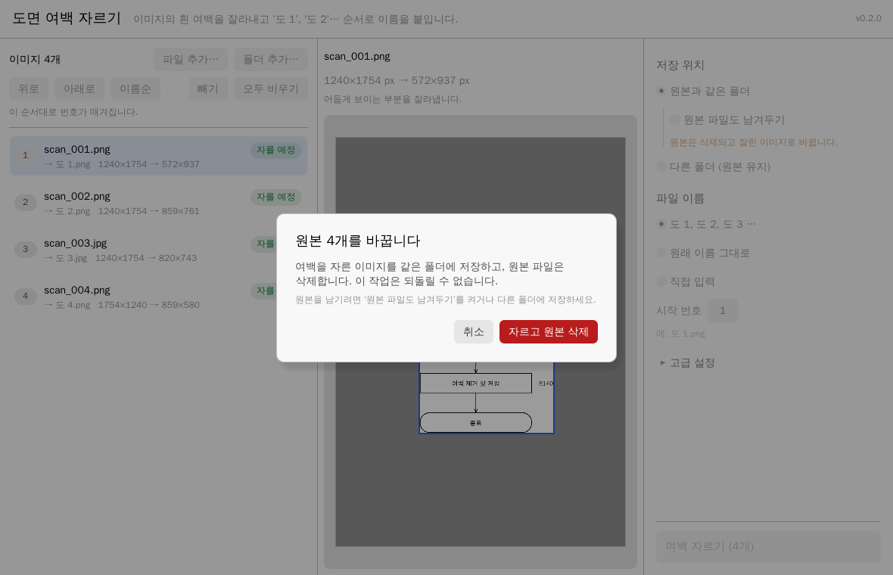
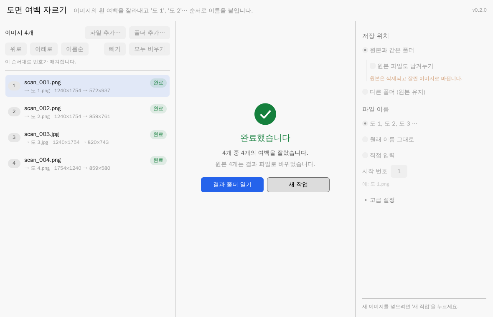
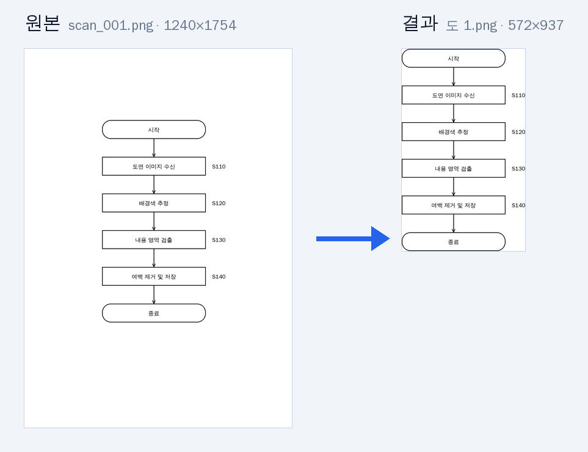

<div align="center">

<a id="top"></a>



# 도면 여백 자르기

**특허 도면의 흰 여백을 한 번에 잘라내고, `도 1` · `도 2` · `도 3` … 으로 이름까지 붙여 주는 도구**

[](https://github.com/lmg6983-dotcom/image_whitespace_killer/releases/latest)
[](https://github.com/lmg6983-dotcom/image_whitespace_killer/releases)
[](https://github.com/lmg6983-dotcom/image_whitespace_killer/actions/workflows/build.yml)
[](LICENSE)


[**📥 내려받기**](#download) · [**🚀 사용법**](#usage) · [**💡 문제 해결**](#faq) · [**⌨️ 명령줄**](#cli) · [**📝 변경 내역**](CHANGELOG.md)

<br>



<sub>실제 화면 — 스캔한 특허 도면 4장을 넣으면 잘려 나갈 여백이 어둡게 표시됩니다</sub>

</div>

<br>

## ✨ 특징

|  |  |
|---|---|
| 🖱️ **끌어다 놓기만 하면 끝** | 이미지나 폴더를 창에 놓고 버튼 하나만 누르면 됩니다. 설치도, 다른 프로그램도 필요 없습니다. |
| 👀 **자르기 전에 미리보기** | 잘려 나갈 부분을 어둡게 보여 줘서 결과를 미리 확인할 수 있습니다. |
| 🔢 **번호는 알아서** | `도 1`, `도 2` … 순서로 이름을 붙입니다. `fig2`가 `fig10`보다 먼저 오도록 자연스럽게 정렬합니다. |
| 🛡️ **실수해도 안전** | 하나라도 실패하면 아무것도 바꾸지 않습니다. 원본을 지우기 전에는 꼭 한 번 더 묻습니다. |
| 🎯 **화질 그대로** | 해상도(DPI)를 유지하고, 여백이 없는 이미지는 다시 압축하지 않고 원본 그대로 둡니다. |
| 🤖 **자동화도 OK** | 명령줄 도구와 JSON 결과로 스크립트나 AI 에이전트에서도 쓸 수 있습니다. |

<a id="download"></a>

## 📥 내려받기

[**최신 버전 내려받기 →**](https://github.com/lmg6983-dotcom/image_whitespace_killer/releases/latest)

| | 🪟 Windows | 🍎 macOS (Apple 칩) | 🐧 Linux |
|---|---|---|---|
| **창 프로그램** · 대부분은 이것 | `trim-image-gui-windows-x86_64.exe` | `trim-image-gui-macos-arm64` | `trim-image-gui-linux-x86_64` |
| 명령줄 도구 · 자동화용 | `trim-image-windows-x86_64.exe` | `trim-image-macos-arm64` | `trim-image-linux-x86_64` |

내려받은 파일을 바로 실행하면 됩니다.

> [!TIP]
> **Windows에서 "Windows의 PC 보호" 창이 뜨면** `추가 정보` → `실행`을 누르세요.
> 서명되지 않은 새 프로그램이면 누구에게나 나오는 안내입니다.

<a id="usage"></a>

## 🚀 사용법

**1️⃣ 넣기** — 도면 이미지나 폴더를 창에 끌어다 놓습니다. `파일 선택…` 버튼도 됩니다.

**2️⃣ 확인하기** — 목록에서 이미지를 누르면 잘려 나갈 부분이 어둡게 표시됩니다.
번호 순서를 바꾸려면 `위로` / `아래로`를 누르세요.

**3️⃣ 실행하기** — 오른쪽 아래 **`여백 자르기`** 를 누르면 끝!

<table>
  <tr>
    <td align="center" width="33%"></td>
    <td align="center" width="33%"></td>
    <td align="center" width="33%"></td>
  </tr>
  <tr>
    <td align="center"><sub><b>확인하기</b> · 잘릴 부분 미리보기</sub></td>
    <td align="center"><sub><b>실행하기</b> · 원본 삭제 전 한 번 더 확인</sub></td>
    <td align="center"><sub><b>끝</b> · <code>도 1</code> ~ <code>도 4</code> 저장 완료</sub></td>
  </tr>
</table>

<p align="center">
  
  <br>
  <sub>실제 결과 — A4 스캔(1240×1754)의 흰 여백만 잘라 <code>도 1.png</code>(572×937)로 저장</sub>
</p>

### 📂 저장 방식

| 설정 | 결과 |
|---|---|
| **원본과 같은 폴더** (기본) | `도 1.png` … 로 저장하고 **원본은 삭제**합니다. 실행 전에 한 번 더 묻습니다. |
| 원본과 같은 폴더 + `원본 파일도 남겨두기` | 원본은 그대로, 결과만 추가로 저장합니다. |
| **다른 폴더** | 고른 폴더에 결과를 저장합니다. 원본은 건드리지 않습니다. |

### 🏷️ 파일 이름

| 설정 | 결과 예시 |
|---|---|
| **도 1, 도 2, 도 3 …** (기본) | `도 1.png`, `도 2.jpg` … (`시작 번호`로 첫 번호 변경) |
| 원래 이름 그대로 | `fig1.png` → `fig1.png` (여백만 잘라냄) |
| 직접 입력: `FIG {번호:02}` | `FIG 01.png`, `FIG 02.png` … |

직접 입력에는 `{번호}`, `{번호:02}`, `{이름}`(원래 이름)을 쓸 수 있습니다.

### ⌨️ 단축키

| 키 | 동작 |
|---|---|
| <kbd>Ctrl</kbd> + <kbd>O</kbd> | 파일 추가 |
| <kbd>Ctrl</kbd> + <kbd>Enter</kbd> | 여백 자르기 실행 |
| <kbd>↑</kbd> / <kbd>↓</kbd> | 이미지 선택 이동 |
| <kbd>Alt</kbd> + <kbd>↑</kbd> / <kbd>↓</kbd> | 선택한 이미지 순서 바꾸기 |
| <kbd>Delete</kbd> | 목록에서 빼기 (파일은 지워지지 않음) |

<a id="faq"></a>

## 💡 문제 해결

<details>
<summary><b>스캔한 도면에 회색 얼룩이나 테두리가 남아요</b></summary>
<br>

`고급 설정` → **흰색 허용 범위**를 10~15%로 올리세요.
</details>

<details>
<summary><b>그림에 너무 바짝 붙게 잘려요</b></summary>
<br>

`고급 설정` → **남길 여백**에 20 px 정도를 넣으세요.
</details>

<details>
<summary><b>배경이 흰색이 아니에요</b></summary>
<br>

`고급 설정` → **배경색**에서 `자동 (모서리 색)`을 고르세요.
</details>

<details>
<summary><b>목록에 <code>빈 이미지</code>라고 나와요</b></summary>
<br>

이미지 전체가 배경색이라 자르지 않았다는 뜻입니다. 내용이 맞는지 직접 확인하세요.
</details>

<details>
<summary><b>목록에 <code>오류</code>라고 나와요</b></summary>
<br>

그 줄에 원인과 해결 방법이 적혀 있습니다. **오류 파일 목록에서 빼기**를 누르면 나머지만 처리할 수 있습니다.
</details>

<details>
<summary><b>예전에 만든 <code>도 1.png</code>가 있으면 덮어쓰나요?</b></summary>
<br>

아니요. 이번 작업과 상관없는 파일은 덮어쓰지 않고 오류로 알려 줍니다. 덮어쓰려면 `고급 설정`에서 켜세요.
같은 폴더에서 다시 실행하는 것은 안전합니다. 이미 자른 `도 1`, `도 2` … 는 그대로 남습니다.
</details>

> [!NOTE]
> 지원 형식: **PNG · JPG · TIF · BMP · GIF · WEBP**
> 움직이는 GIF는 첫 장면만 저장됩니다.

<a id="cli"></a>

## ⌨️ 명령줄 도구

여러 폴더를 한꺼번에 처리하거나 다른 프로그램에서 부를 때 씁니다.

```bash
# 현재 폴더의 이미지를 잘라서 '도 1', '도 2' … 로 저장 (원본 삭제)
trim-image
```

```bash
# 바꾸기 전에 미리보기만 (아무것도 바꾸지 않음)
trim-image ./도면 --dry-run
```

```bash
# 원본은 두고 결과만 다른 폴더에 저장
trim-image ./도면 -o ./완성
```

```bash
# 'FIG01', 'FIG02' … 로 저장하고 여백 10px 남기기
trim-image a.png b.tif --name 'FIG{num:02}' --margin 10
```

<details>
<summary><b>전체 옵션 보기</b></summary>
<br>

| 옵션 | 기본값 | 설명 |
|---|---|---|
| `경로…` | 현재 폴더 | 처리할 이미지 파일 또는 폴더 (하위 폴더는 포함하지 않음) |
| `-o, --out-dir <폴더>` | | 결과를 이 폴더에 저장 (원본 유지) |
| `-k, --keep-originals` | | 원본을 삭제하지 않음 |
| `-n, --name <형식>` | `도 {num}` | 파일 이름 형식. `{num}`, `{num:03}`, `{stem}`(원래 이름) |
| `--keep-names` | | 원래 이름 유지 |
| `--start <N>` | `1` | 시작 번호 |
| `-f, --fuzz <퍼센트>` | `5` | 흰색 허용 범위 (0~100) |
| `-b, --bg <색>` | `white` | 배경색: `white`, `black`, `#RRGGBB`, `auto` |
| `-m, --margin <px>` | `0` | 그림 둘레에 남길 여백 |
| `-q, --quality <Q>` | `95` | JPEG 저장 품질 (1~100) |
| `--overwrite` | | 이미 있는 다른 파일 덮어쓰기 허용 |
| `--allow-partial` | | 일부가 실패해도 성공한 파일은 반영 |
| `--dry-run` | | 미리보기만 하고 아무것도 바꾸지 않음 |
| `--json` | | 결과를 JSON으로 출력 |
| `-Q, --quiet` | | 파일별 출력 생략 |

**종료 코드** — `0` 성공 · `1` 일부 파일 실패 (기본적으로 아무것도 바뀌지 않음) · `2` 잘못된 옵션
</details>

> [!TIP]
> 🤖 AI 에이전트나 스크립트에서 쓰는 방법과 JSON 형식은 [`AGENTS.md`](AGENTS.md)에 정리돼 있습니다.

## 🏗️ 직접 빌드하기

[Rust](https://rustup.rs/)를 설치한 뒤:

```bash
cargo build --release
```

`target/release/`에 `trim-image`(명령줄)와 `trim-image-gui`(창 프로그램)가 만들어집니다.

## 📄 라이선스

[MIT](LICENSE) © lmg6983-dotcom

<div align="right">

[⬆ 맨 위로](#top)

</div>
